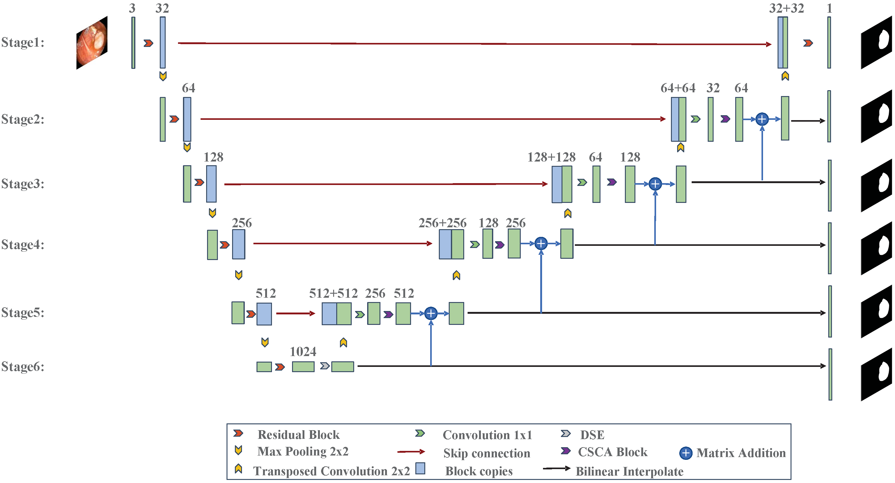
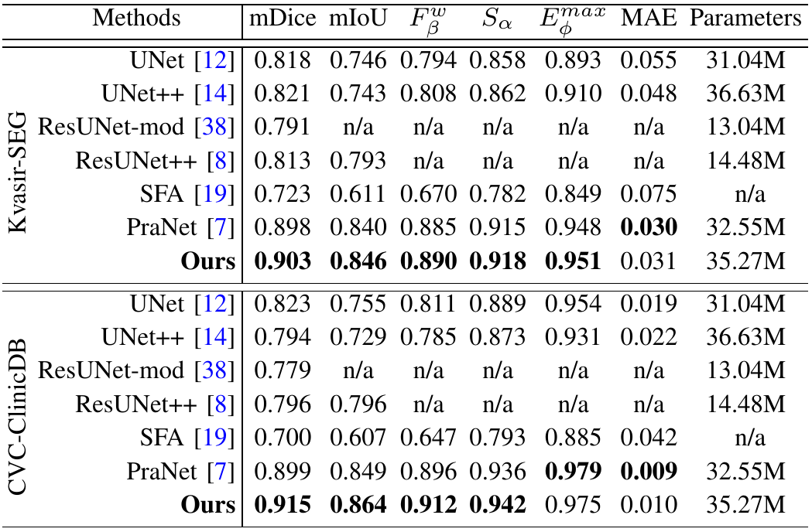
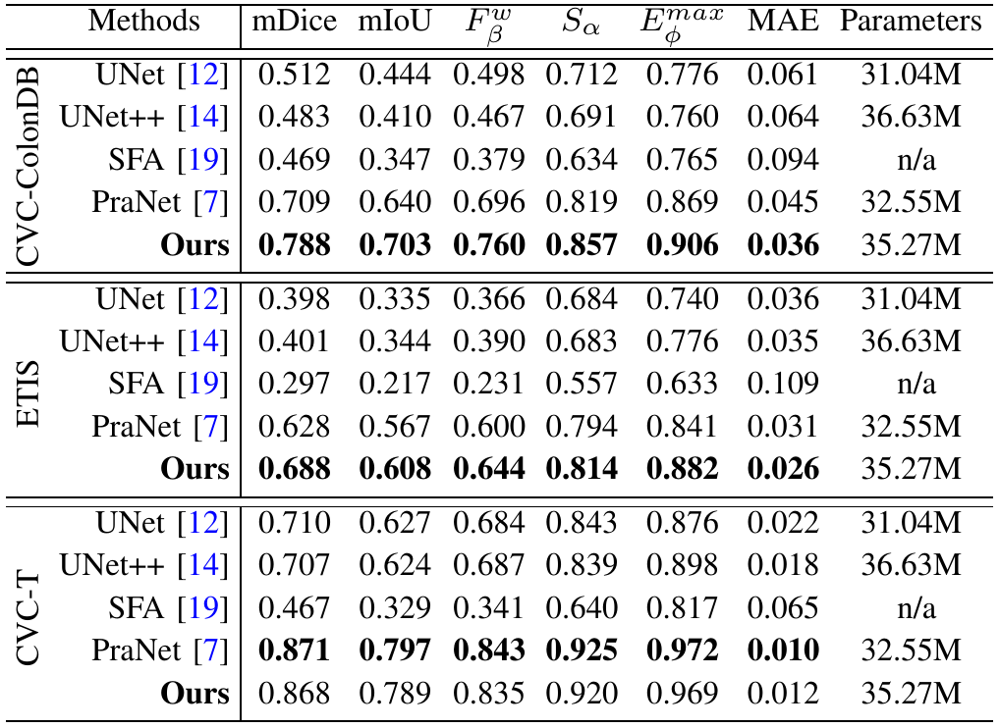
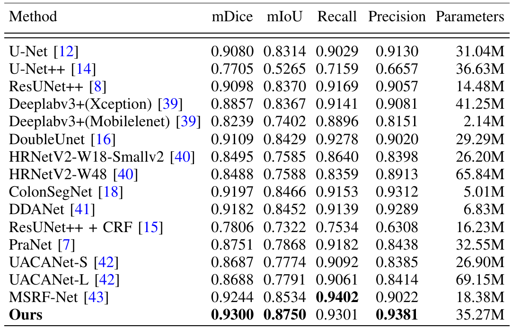
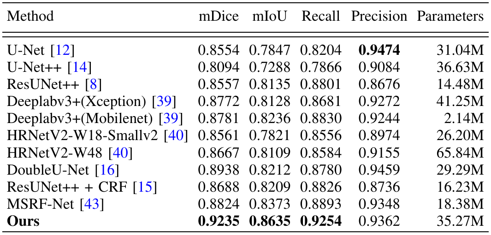
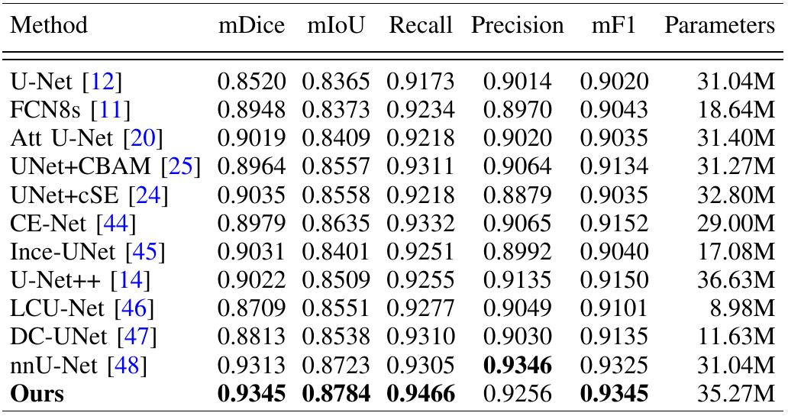
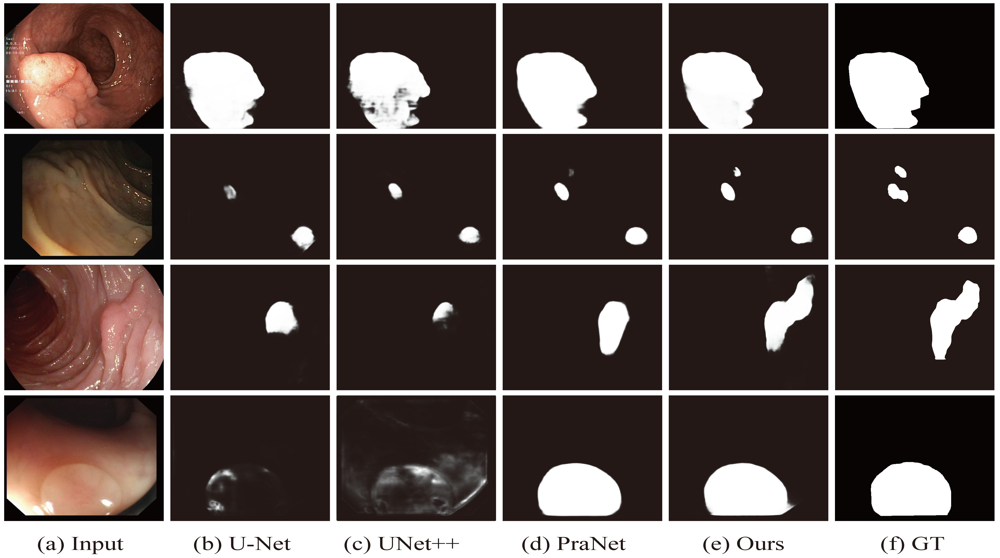
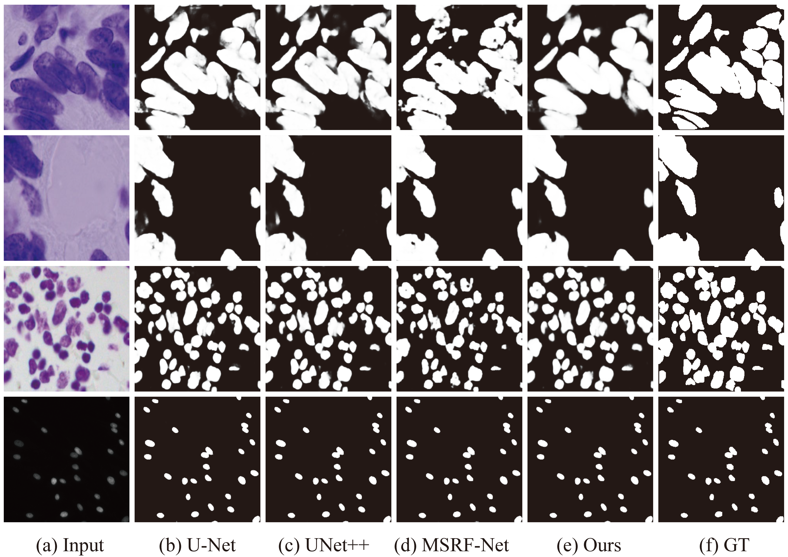
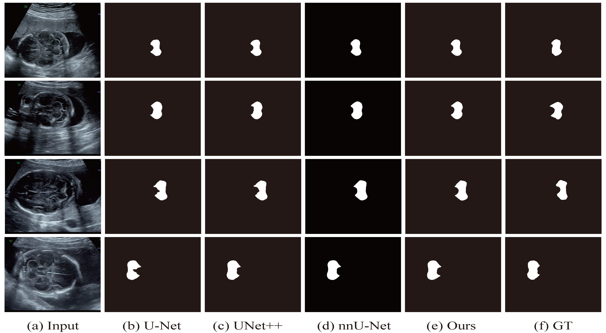

# CSCA U-Net: A Channel and Space Compound Attention CNN for Medical Image Segmentation

----

## 目录
- [CSCA U-Net: A Channel and Space Compound Attention CNN for Medical Image Segmentation](#csca-u-net--a-channel-and-space-compound-attention-cnn-for-medical-image-segmentation)
  * [目录](#目录)
  * [1. 概览](#1-概览)
    + [论文](#论文)
    + [整体架构](#整体架构)
    + [Abstract](#abstract)
  * [2. 数据文件](#2-数据文件)
    + [2.1 数据集](#21-数据集)
    + [2.2 训练好的模型](#22-训练好的模型)
    + [2.3 训练好的预测图](#23-训练好的预测图)
  * [3. 如何运行](#3-如何运行)
    + [3.1 运行环境](#31-运行环境)
    + [3.2 训练模型](#32-训练模型)
    + [3.3 测试模型并生成预测图片](#33-测试模型并生成预测图片)
    + [3.4 评估模型](#34-评估模型)
  * [4. 结果](#4-结果)
  * [5. 引用](#5-引用])
  * [6. 致谢](#6-致谢)
  * [7. 联系方式](#7-联系方式)

<small><i><a href='http://ecotrust-canada.github.io/markdown-toc/'>Table of contents generated with markdown-toc</a></i></small>

---

获取完整的代码：
```shell
git clone --recursive https://github.com/xiaolanshu/CSCA-U-Net.git
```
这将同步`evaldata`文件夹的代码.

## 1. 概览

### 论文

我们的论文"CSCA U-Net: A Channel and Space Compound Attention CNN for Medical Image Segmentation" 发表在 Artificial Intelligence in Medicine.(详情请看, [papers](https://www.sciencedirect.com/science/article/abs/pii/S0933365724000423))

### 整体架构



### Abstract

<p align = "justify"> 
Image segmentation is one of the vital steps in medical image analysis. A large number of methods based on convolutional neural networks have emerged, which can extract abstract features from multiple-modality medical images, learn valuable information that is difficult to recognize by humans, and obtain more reliable results than traditional image segmentation approaches. U-Net, due to its simple structure and excellent performance, is widely used in medical image segmentation. In this paper, to further improve the performance of U-Net, we propose a channel and space compound attention (CSCA) convolutional neural network, abbreviated CSCA U-Net, which increases the network depth and employs a double squeeze-and-excitation (DSE) block in the bottleneck layer to enhance feature extraction and obtain more high-level semantic features. Moreover, the characteristics of the proposed method are three-fold: (1) channel and space compound attention (CSCA) block, (2) cross-layer feature fusion (CLFF), and (3) deep supervision (DS). Extensive experiments on several available medical image datasets, including Kvasir-SEG, CVC-ClinicDB, CVC-ColonDB, ETIS, CVC-T, 2018 Data Science Bowl (2018 DSB), ISIC 2018 Challenge, and JSUAH-Cerebellum, show that CSCA U-Net achieves competitive results and significantly improves the generalization performance.
</p>

## 2. 数据文件

### 2.1 数据集

我们在这一章节提供了论文所使用的公共数据集.

- 息肉数据集 (包括 Kvasir-SEG, CVC-ClinicDB, CVC-ColonDB, ETIS, and CVC-300.) \[[From PraNet](https://github.com/DengPingFan/PraNet)\]:
  - Total: \[[Aliyun](http://drive.little-shu.com/Aliyun/Public/CSCAUNet/Datasets/Polyp%205%20Datasets.zip)\]
  - TrainDataset: \[[Google Drive](https://drive.google.com/file/d/1lODorfB33jbd-im-qrtUgWnZXxB94F55/view?usp=sharing)\] 
  - TestDataset: \[[Google Drive](https://drive.google.com/file/d/1o8OfBvYE6K-EpDyvzsmMPndnUMwb540R/view?usp=sharing)\]
- 2018 Data Science Bowl: \[[Aliyun](http://drive.little-shu.com/Aliyun/Public/CSCAUNet/Datasets/bowl.zip)\], \[[Google Drive](https://drive.google.com/file/d/1IWoWItLWvj1r2SbJWfBQTyPI0AngEwbb/view?usp=share_link)\]
- ISIC 2018 (原始的图片来自于 [[kaggle](https://www.kaggle.com/datasets/pengyizhou/isic2018segmentation/download?datasetVersionNumber=1)\]. I converted the images in `.tiff` format to `.png` format): \[[Aliyun](http://drive.little-shu.com/Aliyun/Public/CSCAUNet/Datasets/ISIC2018.zip)\], \[[Google Drive](https://drive.google.com/file/d/1qSNXHtV526yLLVyayOsA3bSA9LSSPBrQ/view?usp=share_link)\]

###  2.2 训练好的模型

\[[Aliyun](http://drive.little-shu.com/Aliyun/Public/CSCAUNet/snapshots.zip)\], \[[Baidu](https://pan.baidu.com/s/15QcH5fBU4uU0w-X3xu24cw?pwd=1111)\], \[[Google Drive](https://drive.google.com/drive/folders/1GvMXm5fehYbMFfC1mV0wHy0rHk_35JUP?usp=share_link)\]

### 2.3 训练好的预测图

\[[Aliyun](http://drive.little-shu.com/Aliyun/Public/CSCAUNet/Predict_map.zip)\], \[[Baidu](https://pan.baidu.com/s/1KmCXEPkAx5x1QhEx-Utypg?pwd=1111)\], \[[Google Drive](https://drive.google.com/drive/folders/1VA6J9k5XdkanpkMh4IuXe6wg0OS0lUxq?usp=sharing)\]

## 3. 如何运行

### 3.1 运行环境

首先，你需要有一个`pytorch`的环境，我使用的是`pytorch 1.10` , 不过使用较低版本的应该也是可以的，具体情况自行甄别。

也可以使用以下命令，创建一个虚拟环境 (注意: 此虚拟环境名为`pytorch`，如果你的系统中已经有此名称的虚拟环境，你需要手动更改下`environment.yml`)：

```shell
conda env create -f docs/enviroment.yml
```

### 3.2 训练模型

你可以直接运行以下的命令:

```shell
sh run.sh ### use stepLR
sh run_cos.sh ### use CosineAnnealingLR 
```

如果你只想运行单个的数据集，可以注释掉`sh`文件中不相关的一部分，或者直接在命令行输入类似如下命令:

```shell
python Train.py --model_name CSCAUNet --epoch 121 --batchsize 16 --trainsize 352 --train_save CSCAUNet_Kvasir_1e4_bs16_e120_s352 --lr 0.0001 --train_path $dir/data/TrainDataset --test_path $dir/data/TestDataset/Kvasir/  # you need replace ur truely Datapath to $dir.
```

### 3.3 生成预测图片

如果你使用了`sh` 文件进行训练，它会在训练完成后进行测试。

如果你使用了`python`命令进行训练，你也可以注释掉`sh`文件中有关训练的部分，或者直接在命令行输入类似如下命令:

```shell
python Test.py --train_save CSCAUNet_Kvasir_1e4_bs16_e120_s352 --testsize 352 --test_path $dir/data/TestDataset
```

### 3.4 评估模型

- 如果是评估息肉数据集，你可以使用`eval`中的`matlab`代码，或者使用 \[[UACANet](https://github.com/plemeri/UACANet)\] 提供的评估代码。
- 如果是其他的数据集，你可以使用 [evaldata](https://github.com/Tardouse/evaldata/) 代码。
- 之所以使用不同的评估代码，是因为要与在数据集上做实验的其它论文在评估时使用相同的方法。

## 4. 结果

- Polyp Datasets
  

  

- 2018 DSB
  

- ISIC 2018
  

- JSUAH-Cerebellum 
  

- Qualitative Results
  
  - Polyp Segmentation 
  
  - 2018 DSB
  
  - ISIC 2018
  
  - Fetal Ultrasound （Private） 
  
  
## 5. 引用

如果您觉得这项工作对您有所帮助，请您引用它：
```
@article{shu2024102800,
title = {CSCA U-Net: A channel and space compound attention CNN for medical image segmentation},
journal = {Artificial Intelligence in Medicine},
volume = {150},
pages = {102800},
year = {2024},
issn = {0933-3657},
doi = {https://doi.org/10.1016/j.artmed.2024.102800},
url = {https://www.sciencedirect.com/science/article/pii/S0933365724000423},
author = {Xin Shu and Jiashu Wang and Aoping Zhang and Jinlong Shi and Xiao-Jun Wu},
keywords = {U-net, Channel and spatial compound attention, Cross-layer feature fusion, Deep supervision, Medical image segmentation}
}
```


## 6. 致谢

- 本文的很多训练策略、数据集和评估方法都基于 [PraNet](https://github.com/DengPingFan/PraNet)。我对范登平博士等作者的开源精神表示钦佩，并非常感谢`PraNet`这项工作提供到的帮助。

## 7. 联系方式

- 📫 Email: vegas_tyler@outlook.com

-  QQ: 872845991
